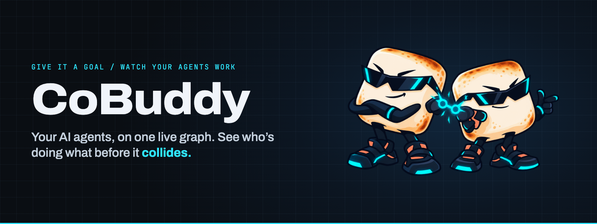
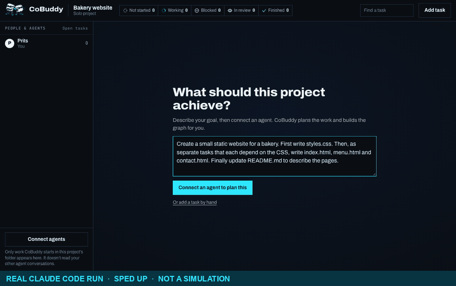
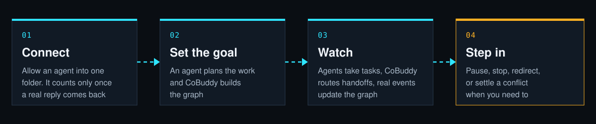
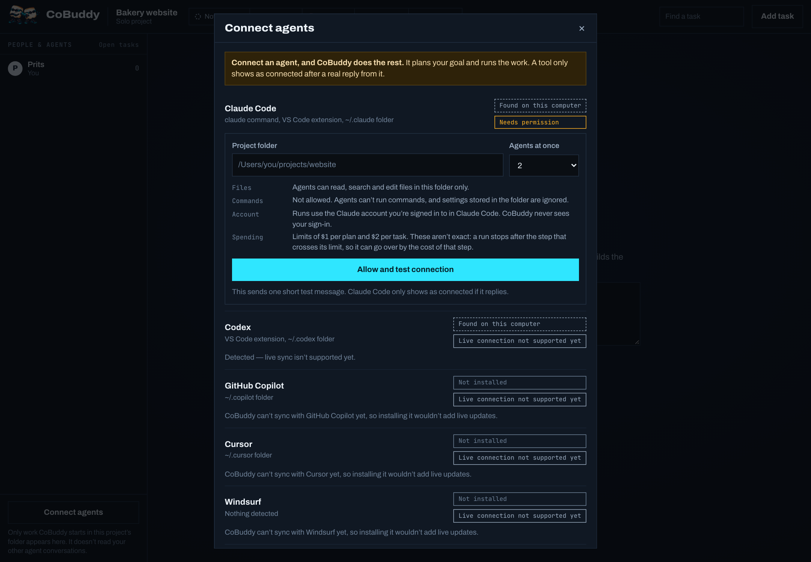
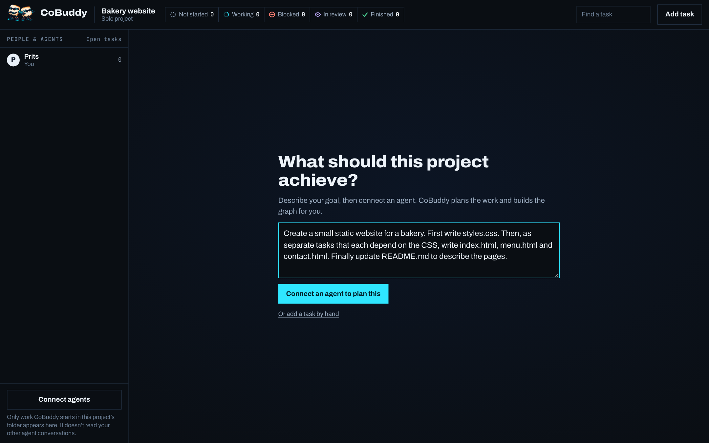
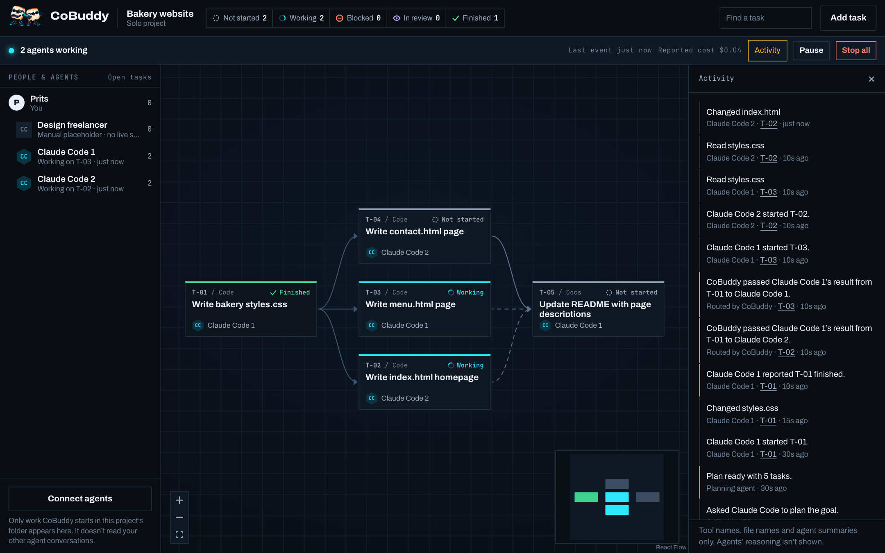
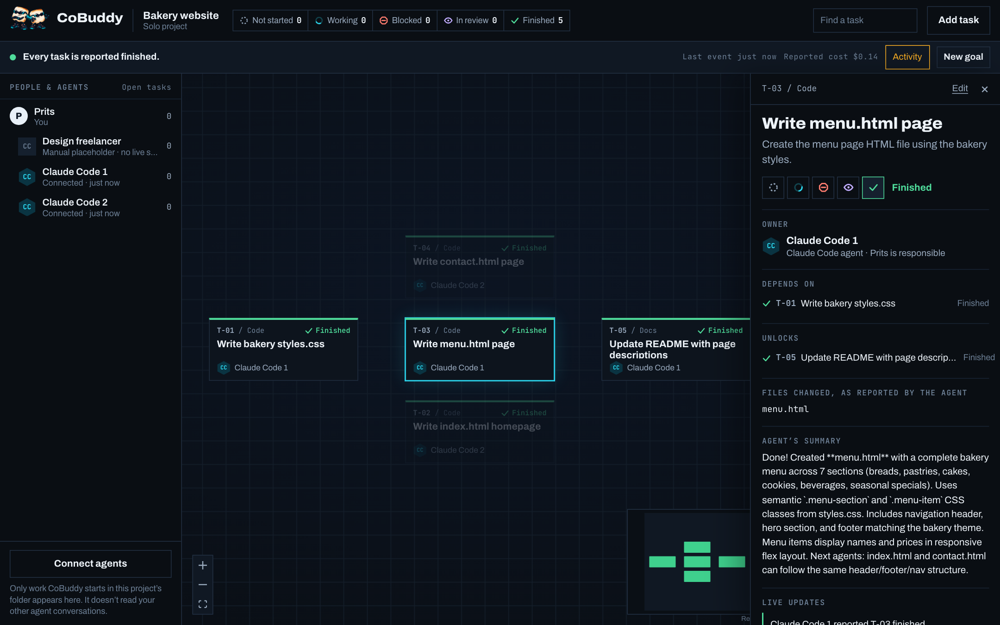

<div align="center">



<h3>Give it a goal. Watch your AI agents build.</h3>

CoBuddy plans the work, hands it to your agents, passes results between them,<br>and shows it all on one live graph.

<br>


**[See it run](#-see-it-run)** &nbsp;·&nbsp; **[How it works](#-how-it-works)** &nbsp;·&nbsp; **[Try it](#-try-it)** &nbsp;·&nbsp; **[What's real](#-whats-real-and-whats-not)** &nbsp;·&nbsp; **[Safety](#-safety-and-privacy)** &nbsp;·&nbsp; **[Roadmap](#-roadmap)**

</div>

---

## 🎬 See it run

<div align="center">



<sub>A real recording, sped up. Two Claude Code agents build a small bakery website in an empty folder. Nothing here is simulated.</sub>

</div>

## 🍡 What CoBuddy is

Running several AI agents at once means being their project manager. You split up the work, copy results from one to the next, and hope two of them don't change the same file.

CoBuddy does that part for you.

<table>
<tr>
<td width="33%" valign="top">

### 🗺️ It plans
Tell it your goal. An agent reads your folder and turns the goal into tasks and a graph.

</td>
<td width="33%" valign="top">

### 🤝 It coordinates
Free agents get the next task. When one finishes, its result goes to the tasks waiting on it.

</td>
<td width="33%" valign="top">

### 👀 You watch
Every card updates from real agent events. Pause, stop or redirect whenever you like.

</td>
</tr>
</table>

## ⚡ How it works



<details>
<summary><b>1. Connect:</b> a tool only counts as connected after a real reply</summary>
<br>

Choose a project folder and how many agents can run at once, then press **Allow and test connection**. CoBuddy sends Claude Code one short message and waits. If there's no reply, it doesn't say connected.



| State | Meaning |
|---|---|
| Not installed | CoBuddy found no working command, app or extension |
| Found on this computer | The tool is here. This says nothing about whether it's connected |
| Needs permission | CoBuddy can connect, once you allow it or sign in |
| Connected — receiving live updates | A real reply has arrived from the tool |
| Live connection not supported yet | CoBuddy can't receive this tool's events, whether or not it's installed |
| Connection lost | An agent stopped reporting or CoBuddy restarted |

</details>

<details>
<summary><b>2. Set the goal:</b> CoBuddy builds the first graph</summary>
<br>

A new project opens by asking what you want to achieve. The plan appears as a graph, and nothing starts until you press **Start agents**.



</details>

<details>
<summary><b>3. Watch:</b> real events, real handoffs</summary>
<br>

The feed shows the files agents touch and the handoffs CoBuddy routes.



Click a task to see its owner, dependencies, changed files, closing summary and latest updates.



</details>

<details>
<summary><b>4. Step in:</b> you stay in charge</summary>
<br>

| Control | What it does |
|---|---|
| **Start agents** | Approves the plan and starts the work |
| **Pause / Resume** | Stops new work from starting. Agents already working finish their task |
| **Stop** | Ends one agent, or all of them, straight away |
| **Cancel planning** | Stops the planning agent and returns to the goal box, with your goal kept |
| **Redirect** | Stops a task and restarts it with your new instruction |
| **Try again** | Restarts a blocked task, with extra instructions if you want |
| **Do this first / It's safe** | Settles an overlap between two tasks |

**Add task** is there if you want extra control, but you don't need it.

</details>

<details>
<summary><b>Conflicts:</b> how CoBuddy keeps agents from colliding</summary>
<br>

Each task lists the files it expects to change, and CoBuddy adds every file an agent reports changing.

- Two tasks that share a file or folder won't start together. The second one waits.
- If agents overlap anyway, the graph shows a **live overlap** and a person decides.
- Tasks that depend on each other, or belong to the same agent, don't count as overlaps.

</details>

## 🚀 Try it

You'll need [Node.js](https://nodejs.org) 20.19+ or 22.12+. For live agents, you'll also need [Claude Code](https://claude.com/product/claude-code) installed and signed in.

From the project folder:

```bash
npm install
npm run dev
```

Open the address Vite prints, usually `http://127.0.0.1:5173`.

**Just looking?** Choose **Team demo** on the start screen. It runs on clearly labelled made-up data and connects to nothing.

<details>
<summary>Commands and settings</summary>
<br>

| Command | What it does |
|---|---|
| `npm run dev` | Runs the app and its local agent bridge |
| `npm test` | Runs the tests |
| `npm run typecheck` | Checks types |
| `npm run build` | Checks types and builds to `dist/` |
| `npm run preview` | Serves the built app, with the agent bridge |

| Environment variable | Default | Purpose |
|---|---|---|
| `COBUDDY_MODEL` | `sonnet` | The model for plans and tasks |
| `COBUDDY_PLAN_BUDGET_USD` | `1` | Spending limit for one plan |
| `COBUDDY_TASK_BUDGET_USD` | `2` | Spending limit for one task |

Project data is saved in your browser. Agent events are saved in `.cobuddy/`, which git ignores.

</details>

## ✅ What's real and what's not

| | Part | State |
|---|---|---|
| ✅ | Claude Code connection, planning, running tasks, live events | Real, through Claude Code's headless mode |
| ✅ | Routed handoffs, overlap checks, pause, stop, redirect | Real |
| ✅ | Agent limit, folder limit | Real, and tested with real agents |
| 🟡 | Spending limits | Real, but not exact. See [Safety](#-safety-and-privacy) |
| 🟡 | Reported cost | As reported by Claude Code. On a subscription it's a guide, not a bill |
| 🟡 | Other tools: Codex, GitHub Copilot, Cursor, Windsurf | Detection only. Installing them won't add live updates |
| 🟡 | Manual placeholders | No live sync. CoBuddy never gives them work, and you update their tasks |
| ⛔ | Claude Code sessions you start yourself | Not shown. CoBuddy only sees agents it starts |
| ⛔ | Team sync and invitations | Not built. Teammates are names in your browser, and all agents run on your computer |
| ⛔ | Finish-time estimates on agent runs | Not shown, because agents don't report progress steps yet |
| 🎭 | Team demo and Solo demo | Made-up data, labelled in the app |

**Good to know**

- Keep the CoBuddy tab open during a run, and use one tab per project. The page hands out the next task, so closing it stops new work, though running agents finish. Reopen it and it catches up. Two tabs on the same project can each hand out work, which can run more agents than you allowed.
- Stopping CoBuddy with Ctrl+C, or closing its terminal, stops its agents first. If it's killed outright, an agent can keep running until the next time CoBuddy starts, when it finds and stops it.
- A connection test gives up after 60 seconds and a plan after 10 minutes.
- Agents edit your folder directly, with no branches and no automatic undo. Use version control.
- "Finished" means the agent reported finishing. CoBuddy doesn't check its work, and agents can't run tests.

<details>
<summary><b>How this was tested</b></summary>
<br>

Every row below was run through the real app with real Claude Code agents, on macOS. Rows marked *(Haiku)* used the cheaper model to save cost, and the rest used the default Sonnet.

| Check | Result |
|---|---|
| Connection test | Showed Connected only after Claude Code replied. Not connected for a missing folder, a file, the home folder, a folder containing it, or `/` |
| Signed out of Claude Code | Stayed on Needs permission with the sign-in message, and could be retried repeatedly |
| Ongoing updates | Events kept arriving throughout each run, not just the test reply |
| Limit of one agent | Never more than one working, measured during the run |
| Redirect mid-task | The agent stopped, and the file reflected the new instruction |
| "Do this first" on a working agent | It stopped, waited behind the other task, and both finished with the file in the new order *(Haiku)* |
| Stop all, stop one, delete a running task | The agents ended each time, with no agent processes left *(Haiku)* |
| Cancel planning | Planning stopped, the goal was kept, and planning again worked *(Haiku)* |
| Plan that fails | The goal screen showed why, in place *(Haiku)* |
| Read outside the folder | Refused, the task was blocked, and the content never appeared |
| Hostile hook inside the project folder | Didn't run *(Haiku)* |
| Spending limit of $0.01 per task | Stopped the task after 1 of 8 files, at $0.018 *(Haiku)* |
| Reload the page mid-run or mid-plan | Picked up where it left off, with each task started once *(Haiku)* |
| Close the tab mid-run, reopen later | The running agent finished, no new task started while closed, and the run completed once reopened *(Haiku)* |
| Server killed mid-run | The page showed lost contact. After a restart it showed Connection lost and a blocked task, the leftover agent was stopped, and Reconnect plus Try again finished the run *(Haiku)* |
| Ctrl+C and terminate | The running agent was stopped each time *(Haiku)* |
| Requests from other websites | Refused, including a foreign Host, a foreign Origin, and a form post |

**Not covered:** tools other than Claude Code, anything other than macOS, two tabs on one project, and runs longer than a few minutes.

</details>

## 🛡 Safety and privacy

<details open>
<summary><b>What agents can do</b></summary>
<br>

- Agents work in the one folder you choose. CoBuddy refuses your home folder, your whole computer, and any folder that contains your home folder.
- They can read, search and edit there. They can't run commands, because no shell is given to them.
- They load no Claude Code settings, neither yours nor any stored in the folder, so a downloaded project can't widen its own access or run its own hooks.
- Runs use the Claude account you're signed in to in Claude Code. CoBuddy never sees your sign-in.
- Limits are $1 per plan and $2 per task by default. These aren't guarantees: a run stops after the step that crosses its limit, so it can go over by the cost of that step. Work done before the stop stays in your folder.

</details>

<details>
<summary><b>What you see</b></summary>
<br>

- The feed shows tool names, file names inside the project, and each agent's closing summary.
- Agents' reasoning and in-progress messages are dropped before they reach the page.
- Search terms, and paths outside the project, aren't shown.
- Only work CoBuddy started appears. Your other Claude Code sessions stay private.
- Agents don't talk to each other directly. CoBuddy copies one agent's closing summary into the next agent's instructions, and the feed marks that as **Routed by CoBuddy**.
- The local API only accepts requests from CoBuddy's own page, so another website can't start an agent on your computer.

</details>

<details>
<summary><b>Adding another agent</b></summary>
<br>

Each tool is an adapter in `server/agents/`. It starts the tool and turns its real events into CoBuddy's common reports. Implement `AgentAdapter` from `server/agents/types.ts`, then register it in `server/agents/index.ts`. Only add a tool if it can provide real events.

</details>

## 🗺 Roadmap

These are plans, not finished features.

- [ ] Adapters for more agents, starting with tools that offer a real event stream
- [ ] Showing Claude Code sessions you start yourself, through opt-in hooks
- [ ] Coordination that keeps going with the page closed
- [ ] A separate git branch for each task
- [ ] Real shared projects and teammate invitations

## 🤲 Contributing

Contribution guidelines haven't been written yet. Until then, please open an issue to discuss a change, and run `npm test` and `npm run typecheck` before sending one.

## 📄 License

No license has been chosen yet.
